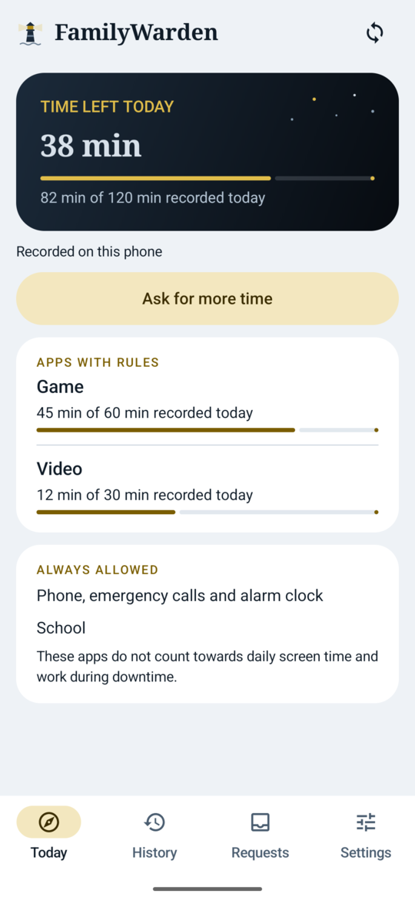
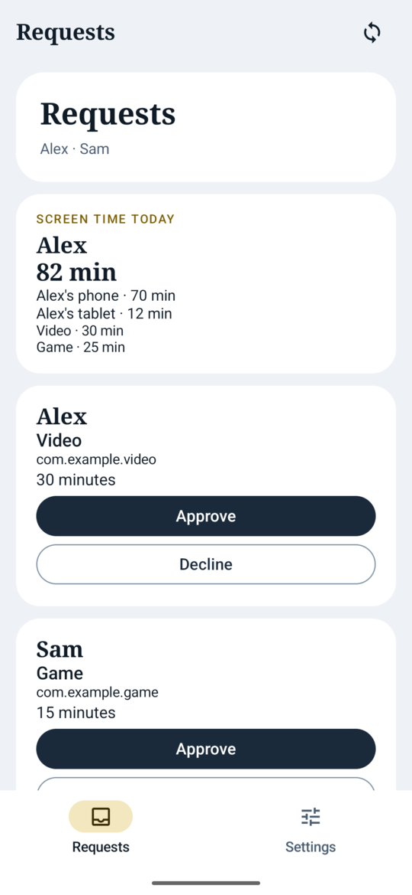
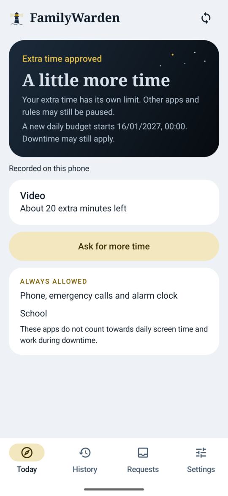
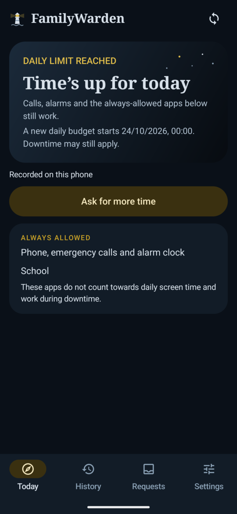
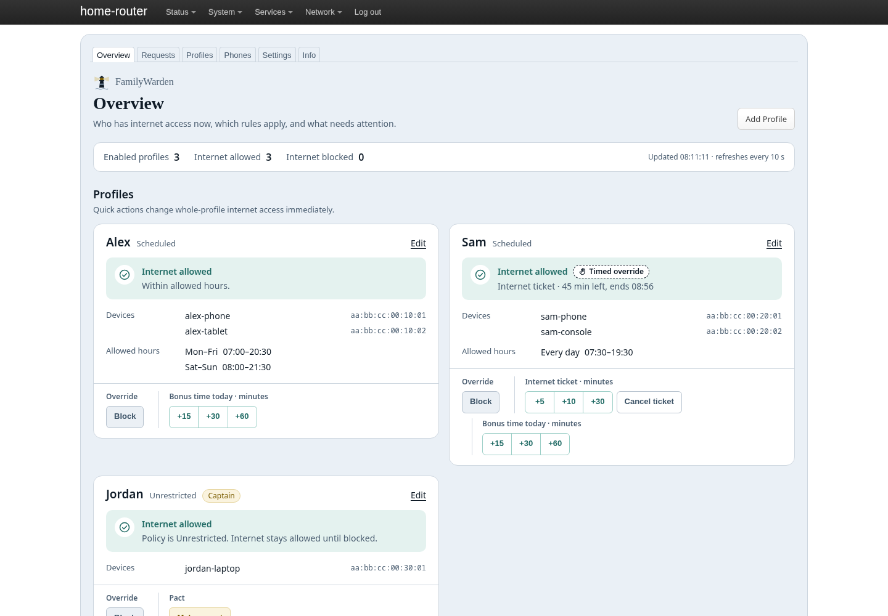
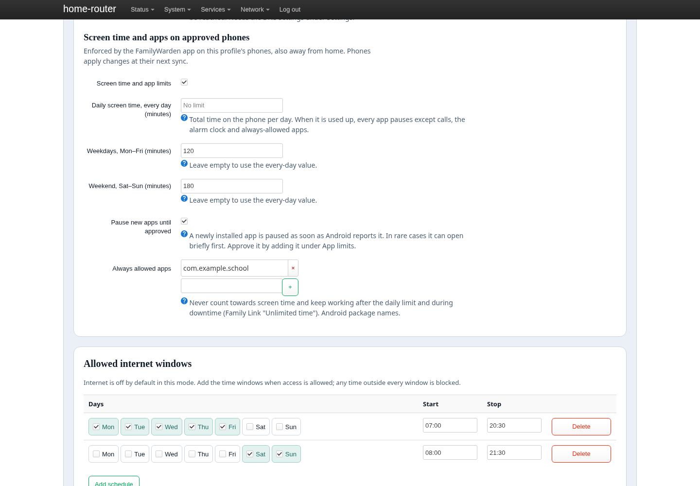
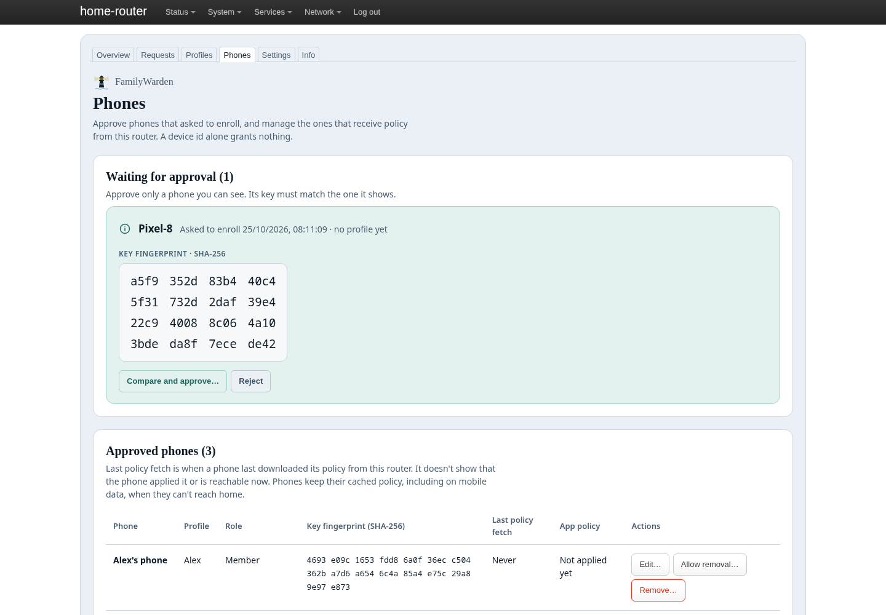
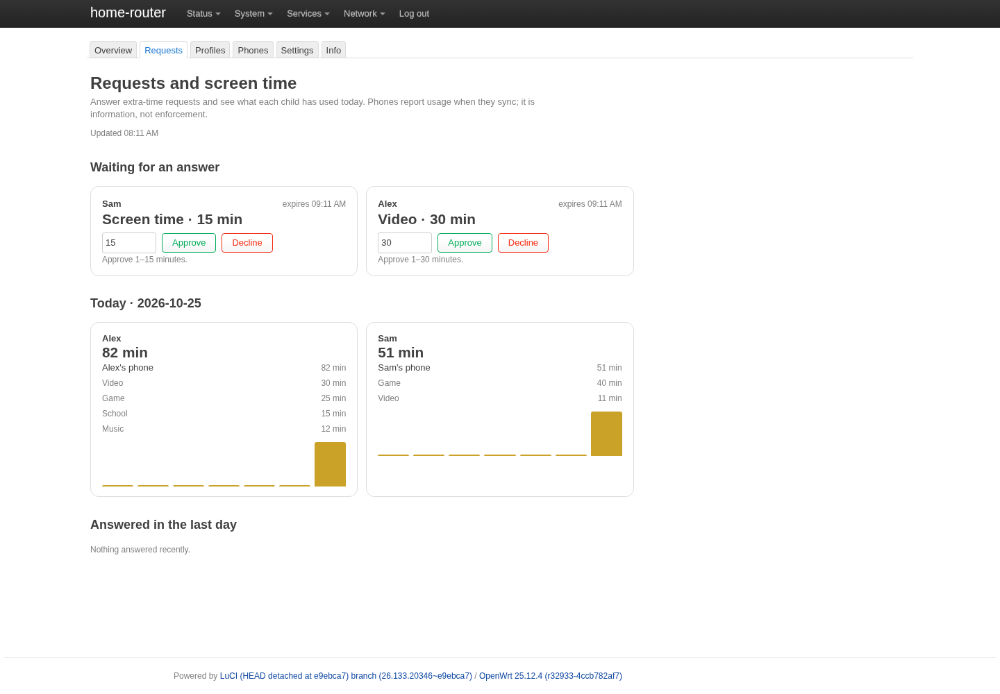

# FamilyWarden - OpenWrt Parental Control

[](https://github.com/denogio/familywarden/actions/workflows/ci.yml)

Profile-based parental control for OpenWrt: schedules, per-device internet blocking,
and time-limited "tickets" — exposed through ubus for LuCI, Home Assistant, and other clients.

Schedules and tickets are enforced by the kernel (nftables `meta hour`/`meta day` and a
timeout set), without a polling daemon or cron job for schedule evaluation.

## FamilyWarden app (Android, in development)

The phone app keeps strict, filtered DNS (DNS-over-TLS through AdGuard Home) on the
phone at home and away, and optionally enforces Ulysses on hotspot and tethering. A phone
only gets a policy after an administrator approves it in LuCI by comparing its fingerprint.
English and Danish. Status and open items: [plans/android-implementation.md](plans/android-implementation.md).

In development (not released yet): screen time and app limits in the style of Google
Family Link, and **extra-time requests** — a child asks for more minutes, a parent approves
or declines on their own phone (no Device Owner needed), and the approved minutes expire
two hours after approval without changing the standing rules. Phones report their screen time
to the router, so parents see each child's day on their phone and in LuCI.

<p>




</p>

### LuCI (router web interface)

<p>

</p>
<p>


</p>
<p>

</p>

Screenshots use a fictional family and are regenerated with
`scripts/capture-readme-screenshots.sh` (throwaway containers and emulator only).

### Children's Google accounts (app control)

The intended setup uses a separate, ordinary (non-Family-Link-supervised) Google account
for each child, with FamilyWarden providing app limits and usage reporting. App control is
**in development and not released**; see [the plan](plans/app-control.md).

**Google account warning:** Using an unsupervised account for a child below Google's
applicable minimum age may violate Google's account rules and could result in account
restrictions or suspension. Minimum ages vary by country. FamilyWarden does not waive
these requirements, and a separate or parent-owned account is not a guaranteed exception.
Check [Google's age requirements](https://support.google.com/accounts/answer/1350409)
before choosing this setup. We do not recommend providing a false date of birth.

## Installation

Download the packages from the latest [release](https://github.com/denogio/familywarden/releases)
(OpenWrt 25.12+): `familywarden` and `luci-app-familywarden` are architecture-independent;
`familywarden-core` (the Go core, required since 0.11) exists per architecture. Pick the one
matching `DISTRIB_ARCH` in `/etc/openwrt_release`, e.g. on an `aarch64_cortex-a53` router:

```sh
apk add --allow-untrusted ./familywarden-core-*-aarch64_cortex-a53.apk ./familywarden-[0-9]*.apk ./luci-app-familywarden-*.apk
```

Then open **Services → FamilyWarden** in LuCI.

## Structure

```
familywarden/                     # Backend package
├── usr/lib/rpcd/familywarden     # ubus API + nft include compiler (→ /usr/libexec/rpcd)
├── etc/init.d/familywarden       # procd: regenerate at boot and after UCI changes
├── etc/config/familywarden       # UCI configuration
└── usr/share/rpcd/acl.d/         # ACL

luci-app-familywarden/            # LuCI frontend (JS views)
scripts/                          # Build, test, and deployment tools
test/e2e/                         # Playwright tests against LuCI
```

## Development

```sh
./scripts/test-syntax.sh          # Static checks
./scripts/test-integration.sh     # Real fw4 + nftables in an OpenWrt container (Docker)
./scripts/test-agh.sh             # AdGuard Home sync against a throwaway AdGuard Home container
./scripts/build-apk-docker.sh     # Build apk packages with the OpenWrt SDK → dist/
./scripts/test-apk.sh             # Install/uninstall built packages in a container
./scripts/deploy.sh root@router   # Copy source files directly to a router
```

### QEMU test router (no root required)

```sh
./scripts/qemu-dev.sh start --fresh   # Fresh OpenWrt 25.12 instance (KVM)
./scripts/qemu-dev.sh deploy          # Build, install, and create test profiles (Dennis = captain)
./scripts/qemu-dev.sh time "21:29"    # Set router time, e.g. just before blocking starts
./scripts/qemu-dev.sh console         # Serial console (also works during lockdown)
```

LuCI: http://localhost:8080 (root / ulysses). Sail page: http://localhost:7700.
Your machine is a LAN client (192.168.1.2), so Ulysses lockdown affects it like any other device.

CI runs tests → build → package smoke tests on each push. A `vX.Y.Z` tag matching
`PKG_VERSION` in `familywarden/Makefile` publishes a GitHub release with the packages.

## API

```sh
ubus call familywarden list
ubus call familywarden status '{"profile":"alex"}'
ubus call familywarden block  '{"profile":"alex"}'
ubus call familywarden allow  '{"profile":"alex"}'
ubus call familywarden reset  '{"profile":"alex"}'
ubus call familywarden ticket '{"profile":"alex","minutes":30}'
ubus call familywarden pact   '{"until":0,"window_day":"sun","window_start":"10:00","window_stop":"11:00"}'
ubus call familywarden reload
ubus call familywarden version
```

## Ulysses — bind yourself to the mast

Select your own profile as the *Ulysses profile* (captain) in Settings, then make a **pact**:
until a specific time, or ongoing with a weekly amendment window.

- While the pact is active, your profile is frozen: no edits, Allow actions, or tickets outside the amendment window.
- While you are blocked, TCP access to the router is restricted for all devices, with exceptions for DNS and the sail page.
- The supported early exit is the **sail page on port 7700**: router password, a line from
  Josh Garrels' "Ulysses", then a waiting period (24 hours by default).
- **Ulysses Mast** (Android app) blocks hotspot and tethering on your phone during the same periods,
  closing the mobile-hotspot loophole. See [docs/ulysses-mast.md](docs/ulysses-mast.md).

## License

Apache 2.0
