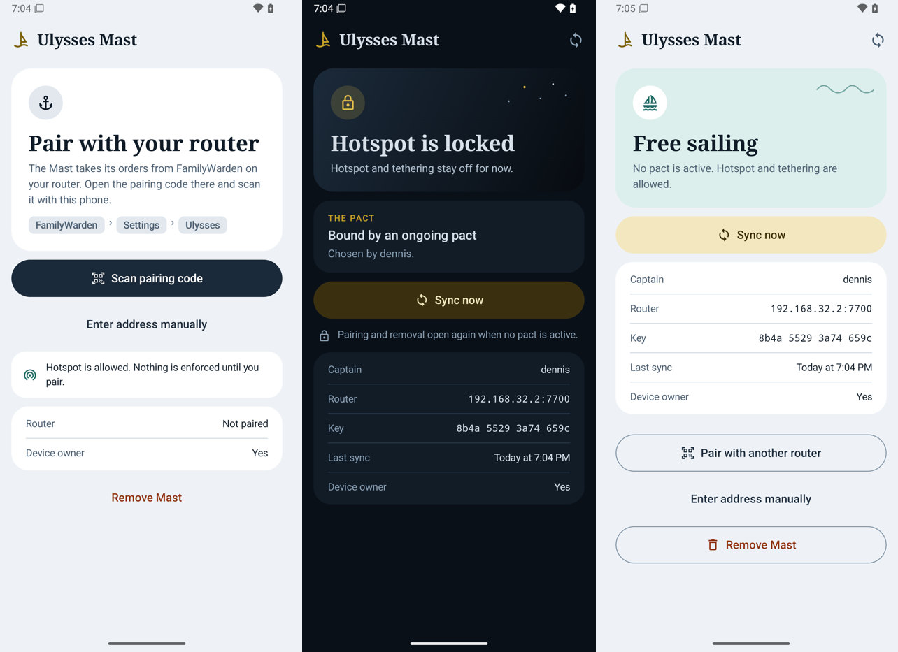

# Ulysses Mast

> This guide describes the released v0.8.0 Mast app and its existing Device Owner
> identity. Local development of the differently packaged FamilyWarden app is tracked
> in [the implementation checkpoint](../plans/android-implementation.md). It is not an
> in-place update: do not remove/reset your current owner to install that branch. — make your phone part of the mast

Ulysses Mast is a small Android app for the captain's phone. While a pact is active
and your schedule blocks access, it restricts **hotspot and tethering** (Wi-Fi, USB,
Bluetooth). Android is responsible for stopping existing tethering when the restriction
is applied; physical-device behavior has not yet been verified.

The app is the phone's *Device Owner*, Android's device-management mechanism. This lets
it enforce restrictions that an ordinary app cannot impose on the phone's owner.



## User interface

The app uses Jetpack Compose and Material 3 with light/dark themes, serif headlines,
and a night-sea card when blocked. Status, pact, sync, and router details come from
the same signed cache used for enforcement. Pairing and removal are hidden during a pact.
The countdown to the next lock/unlock shows an actual change, not merely the next
alarm evaluation. The screen also updates when a pact expires locally without a new sync.

## How it works

- The app fetches the pact and schedule from `http://<router>:7700/cgi-bin/mast`.
  That port remains accessible during lockdown.
- Responses are signed with the router's key (usign/Ed25519). The app rejects responses
  not signed by its paired router and responses older than the last accepted server timestamp.
- The app caches the last verified response and evaluates the schedule locally, including
  when the router is unreachable, such as at work. Hotspot is allowed during allowed windows
  and blocked outside them while bound. The cache has no age-based expiry. A finite pact
  or an already-synced release can expire locally.
- Release builds disable adb while blocked. While paired, time and timezone are locked to
  automatic settings so changing the clock cannot move you into an allowed window.
- Android protects a Device Owner app against ordinary uninstall, data clearing, and
  force-stop attempts. This is not an absolute security boundary against root, recovery,
  or a factory reset.

## Installation

You need a computer with `adb` and USB debugging enabled on the phone
(*Settings → About phone →* tap *Build number* seven times, then
*System → Developer options → USB debugging*). Menu names vary by device.

### 1. Prepare accounts and profiles

Device Owner enrollment through adb normally requires a phone without accounts or
incompatible additional profiles.

**Back up first.** Removing an account is not a factory reset, but what gets removed
locally depends on the app and account type. Synced data can usually be downloaded
again; unsynced data and data in deleted profiles may be lost. Check backups, recovery
codes, and account synchronization before removing anything. Enrollment on a physical
phone has not been verified; Android version, manufacturer, and existing profiles may
mean a factory reset is required.

Check these before proceeding:

- [ ] **Two-factor codes:** back up or export authenticator codes first.
- [ ] **WhatsApp, Signal, and similar apps:** check account dependencies and back up chats.
- [ ] **Google Wallet:** payment cards may need to be added again.
- [ ] **Private space or work profiles:** removing a profile deletes its local data.

Review accounts under *Settings → Passwords and accounts*, including accounts registered
by password managers, messaging apps, and other services, not just Google accounts.

`adb shell dumpsys account` shows accounts that remain.

### 2. Install and enroll

Restart the phone and wait a minute. Android checks accounts asynchronously after boot.
Download `ulysses-mast-<version>.apk` from the latest
[release](https://github.com/denogio/familywarden/releases) containing Mast:

```sh
adb install ulysses-mast-0.8.0.apk
adb shell dpm set-device-owner me.hojgaard.ulysses.mast/.MastAdminReceiver
```

If you see *"already some accounts on the device"*, check for remaining accounts.
Immediately after boot, waiting briefly and retrying may also be necessary.
`adb logcat -b system | grep -i account` can help identify the cause.

### 3. Sign in again

Once Device Owner enrollment succeeds, add your accounts again.

### 4. Pair with the router

1. Open LuCI on your home network: *FamilyWarden → Settings → Ulysses → Ulysses Mast*.
2. Open **Mast** on the phone and tap **Scan pairing code**.
3. Scan the QR code and check that the fingerprint matches the one in LuCI.

The captain's card in LuCI now shows "📱 Mast synced …".

**After creating a pact**, sync the phone and check its displayed status. Background
sync is scheduled every 15 minutes, subject to Android scheduling and network availability;
**Sync now** requests an immediate attempt. LuCI's last-sync display records a fetch,
not an acknowledgment that enforcement succeeded. A new pact must reach the phone
before it can be enforced there.

## Remove Mast

When paired, **Remove Mast** requires a fresh, verified router response confirming
that no pact is active. This is checked again when you confirm removal. The app clears
its restrictions and relinquishes Device Owner rights, after which it can be uninstalled
normally. An unpaired installation can also relinquish Device Owner rights.

During a pact, the supported early exit is the sail page on port 7700 followed by
the waiting period. A factory reset also removes the app and its local data.

## Updating

```sh
adb install -r ulysses-mast-<new-version>.apk
```

For release builds, adb updates are possible only outside blocked periods.
Updates must be signed with the same key as the installed app. The key is stored in
GitHub secrets (`MAST_KEYSTORE_B64`) and locally at `~/.config/familywarden/mast-release.jks`.
**If the key is lost, the existing installation cannot be updated.** Removing and
re-enrolling Mast requires completing the normal release/removal flow or resetting the phone.

## Testing

- `android/`: `./gradlew testDebugUnitTest lintDebug assembleDebug assembleRelease`.
  Latest Android checkpoint: 199 JVM tests covering policy/signatures, roles, pairing,
  removal, usage/grants and UI mapping/selection.
- `scripts/test-mast-emulator.sh <router-apk-dir>`: Android 15 emulator with the debug APK
  as Device Owner against a FamilyWarden router in Docker. Covers real pairing confirmation,
  Compose in light/dark themes and 200% text, pacts, release, new pacts, offline reboot,
  and refusal of `pm clear` and uninstall. A removal dialog opened before a new pact
  must not allow removal afterward. Also verifies successful removal after a fresh release
  and same-key numeric address repair while bound (foreign key, unreachable endpoint and
  unsigned response refused; endpoint/pin/device identity preserved).
  CI runs it through *workflow_dispatch* with `mast_emulator`.
  Set `MAST_SCREENSHOT_DIR=/tmp/mast-ui` to save screenshots.
- `scripts/test-requests-emulator.sh <router-apk-dir> [debug.apk]`: real signed child
  request, restart-safe grant consumption, new-app approval and a parent phone without
  Device Owner. Both native suites pass at the 2026-10-26 validation checkpoint.
- API 35 test guests use the established user-mode Wi-Fi backend
  (`-feature -WiFiPacketStream`): emulator 37.2.12's packet-stream backend produced no
  guest network in this environment. `scripts/wait-emulator-router.sh` waits for a real
  zero-I/O TCP connection, not merely Android boot completion or an incomplete HTTP probe.
  Temporary emulator/router containers are resource-capped and removed after the tests.
  These settings change test infrastructure only, not phone policy or production networking.
- Release builds use R8 minification and resource shrinking (about 4.1 MB locally).
  Emulator runtime tests use debug builds; physical hotspot/Pixel behavior is not yet tested.
